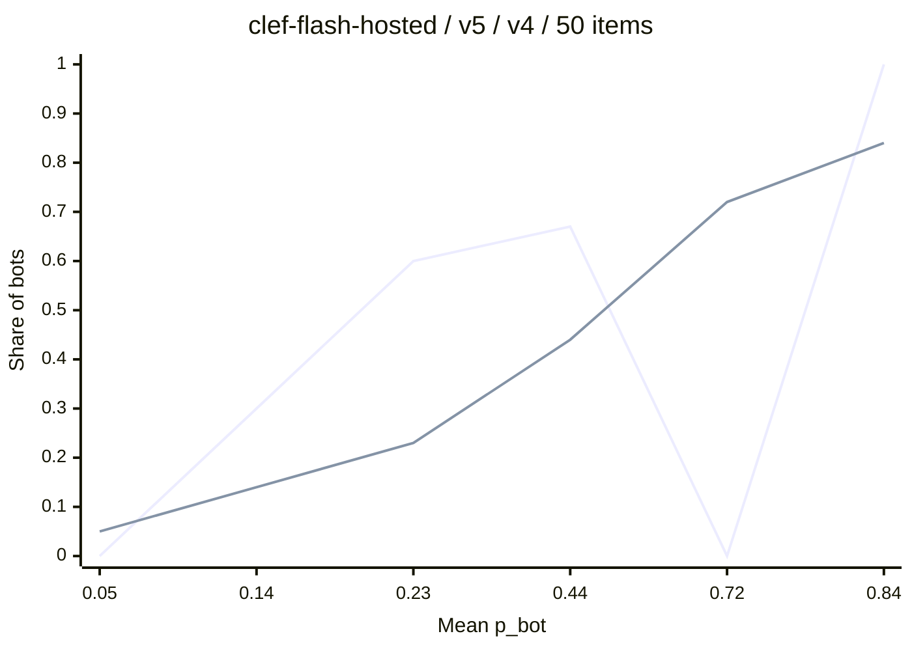
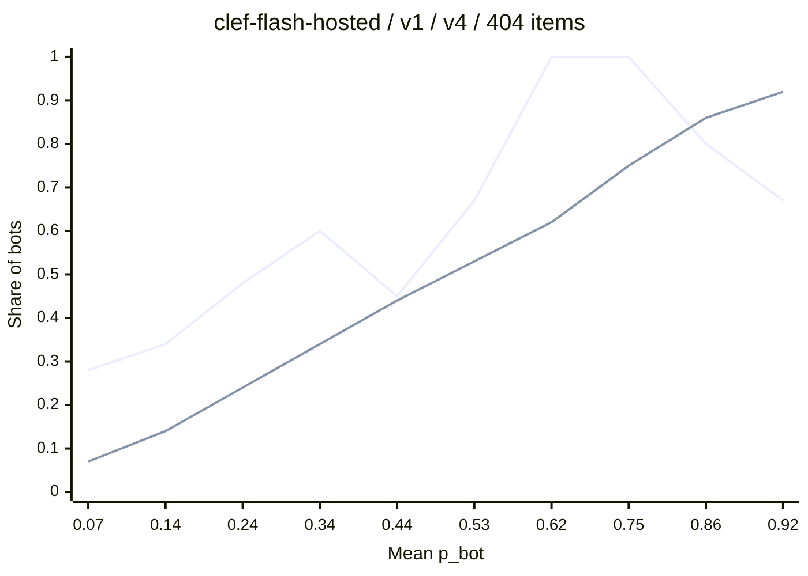
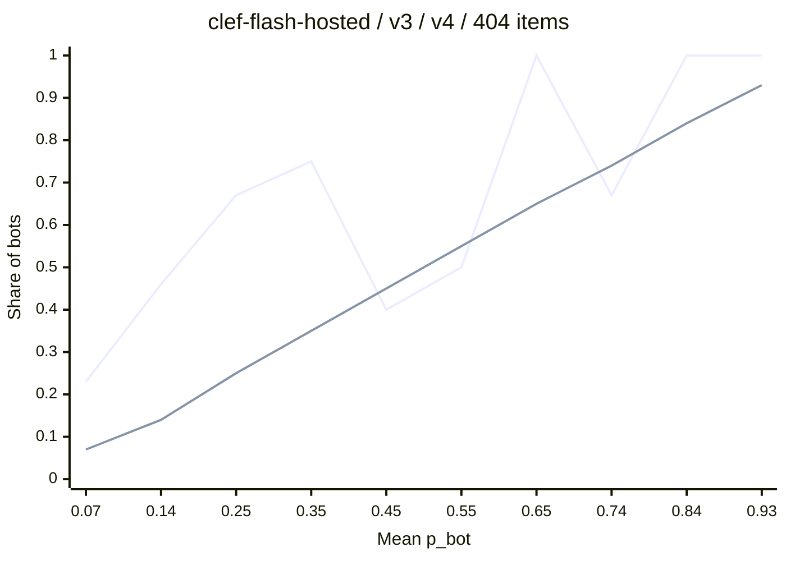
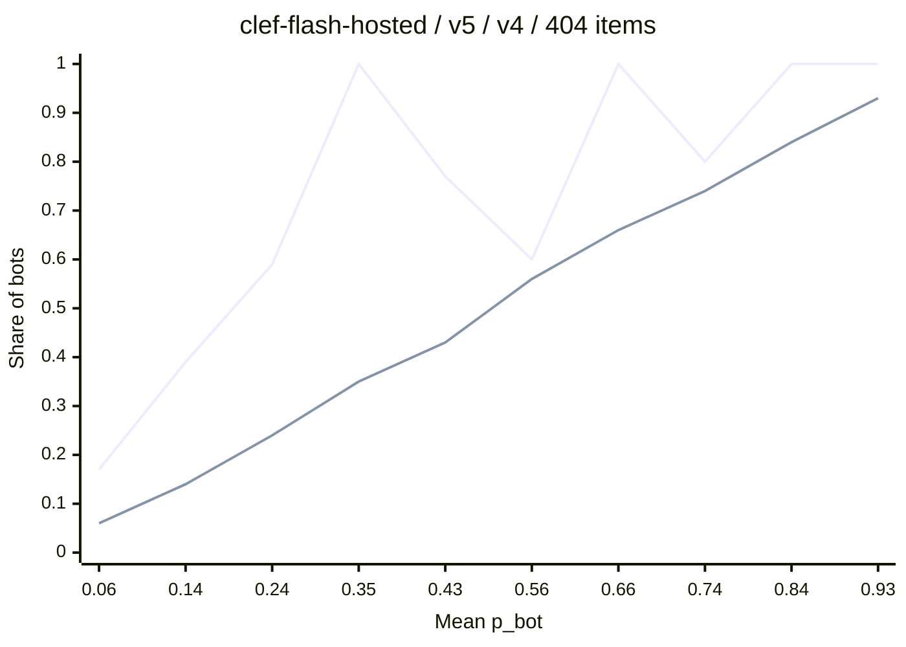
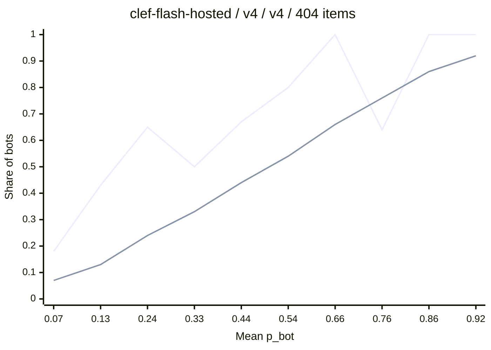
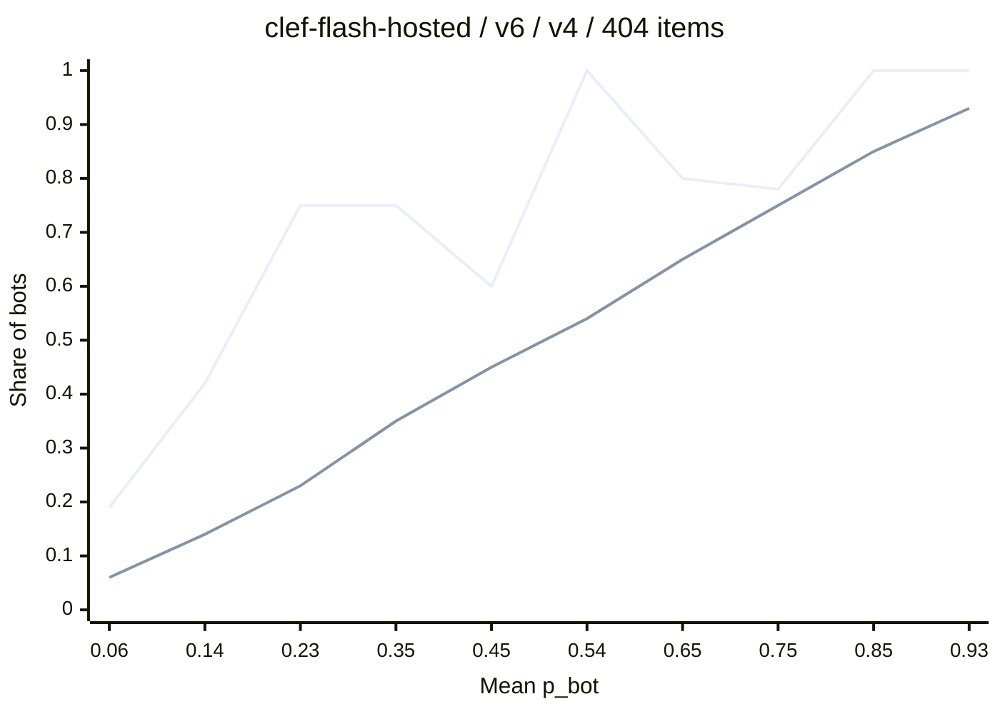

# Eval report

Split seed: 20261030. The threshold comes from the tune split. Every metric uses the test split.

## Results

`eval report` writes every section from "Comparison" down. You write this section by hand. A new `eval report` run replaces the whole file, so copy this section first.

### Labels

- The eval set holds 404 accounts: 243 human, 119 bot, 42 agent. `join` dropped 21 accounts with the label `unsure`.
- A Claude Haiku label agent wrote the labels. You reviewed a blind sample of 40 accounts.
- Your agreement rate with the label agent: 60% on the exact label, 65% on bot versus human. This rate bounds every number in this report.
- 12 of the 14 bot-versus-human disagreements were organisation accounts. A new rule says that newsrooms are human and auto-posted promotion is bot. The label agent applied it to 285 accounts and changed 26 labels. Your 40 labels replace the label agent's.

### Repeatability (task 4.11)

All 5 repeats of 50 items returned the same `p_bot`. Clef-flash is repeatable: one run per item is enough.

### Metadata versions

| Metadata version | Fields | ROC-AUC | F1 | Extra twitterapi.io calls |
|---|---|---|---|---|
| `v1` | tweet text | 0.666 | 0.585 | none |
| `v2` | + account fields | 0.707 | 0.626 | none |
| `v3` | + rates | 0.713 | 0.609 | none |
| `v4` | `v3` + recent tweets | 0.751 | 0.603 | one for each account |
| `v6` | `v3` + profile | 0.780 | 0.655 | none |
| `v5` | `v3` + recent tweets + profile | 0.812 | 0.678 | one for each account |

The default is `v6` with question version `v4`. `v5` scores 0.03 higher in ROC-AUC, but a query with 20 accounts then costs about 0.06 USD on twitterapi.io instead of 0.003 USD. With a 65% agreement rate, a gap of 0.03 may be noise.

### Bot threshold (task 4.12)

Clef-flash gives low `p_bot` values. The best F1 on the tune split of `v6` is at 0.123, and `BOT_THRESHOLD` takes that value. A margin of 0.05, to 0.173, would cover kinds of speech and data that the 16 queries did not reach. `main.tf` holds that value as a comment.

| Threshold on the `v6` test split | Precision | Recall | Recall (bot) | Recall (agent) | F1 |
|---|---|---|---|---|---|
| 0.123 | 0.618 | 0.697 | 0.716 | 0.643 | 0.655 |
| 0.173 | 0.740 | 0.523 | 0.531 | 0.500 | 0.613 |
| 0.5 | 0.885 | 0.211 | 0.247 | 0.107 | 0.341 |

### Field gaps (task 4.13)

The search result of twitterapi.io carries every field of `v1` to `v6` for all 404 accounts. Some accounts leave profile fields blank: 35 have no bio, 206 have no website, and 162 have no location. `v6` needs no recent tweets, so the production scraper fetches none.

### LLM text (task 4.14)

On `v6`, across all 404 accounts:

- LLM text does not raise `p_bot` for humans. The 19 humans with an LLM-text tweet average 0.103. The 224 others average 0.108.
- `p_llm_text` finds LLM text with ROC-AUC 0.797 against the `is_llm_text` flag: 60 tweets with the flag, 344 without.

## Comparison

| Model version | Metadata version | Question version | Items | Bot threshold | Accuracy | Precision | Recall | F1 | ROC-AUC | Brier | ECE | Recall (bot) | Recall (agent) |
|---|---|---|---|---|---|---|---|---|---|---|---|---|---|
| `clef-flash-hosted` | `v5` | `v4` | 50 | 0.225 | 0.735 | 0.556 | 0.500 | 0.526 | 0.858 | 0.171 | 0.170 | 0.500 | 0.500 |
| `clef-flash-hosted` | `v1` | `v4` | 404 | 0.127 | 0.617 | 0.514 | 0.679 | 0.585 | 0.666 | 0.257 | 0.203 | 0.691 | 0.643 |
| `clef-flash-hosted` | `v2` | `v4` | 404 | 0.087 | 0.642 | 0.536 | 0.752 | 0.626 | 0.707 | 0.261 | 0.230 | 0.765 | 0.714 |
| `clef-flash-hosted` | `v3` | `v4` | 404 | 0.113 | 0.672 | 0.579 | 0.642 | 0.609 | 0.713 | 0.259 | 0.226 | 0.642 | 0.643 |
| `clef-flash-hosted` | `v5` | `v4` | 404 | 0.132 | 0.734 | 0.653 | 0.706 | 0.678 | 0.812 | 0.225 | 0.203 | 0.716 | 0.679 |
| `clef-flash-hosted` | `v4` | `v4` | 404 | 0.154 | 0.712 | 0.667 | 0.550 | 0.603 | 0.751 | 0.239 | 0.206 | 0.556 | 0.536 |
| `clef-flash-hosted` | `v6` | `v4` | 404 | 0.123 | 0.708 | 0.618 | 0.697 | 0.655 | 0.780 | 0.244 | 0.218 | 0.716 | 0.643 |

## Label counts

| Experiment | Tune human | Tune bot | Tune agent | Test human | Test bot | Test agent |
|---|---|---|---|---|---|---|
| clef-flash-hosted / v5 / v4 / 50 items | 10 | 4 | 2 | 24 | 8 | 2 |
| clef-flash-hosted / v1 / v4 / 404 items | 78 | 38 | 14 | 165 | 81 | 28 |
| clef-flash-hosted / v2 / v4 / 404 items | 78 | 38 | 14 | 165 | 81 | 28 |
| clef-flash-hosted / v3 / v4 / 404 items | 78 | 38 | 14 | 165 | 81 | 28 |
| clef-flash-hosted / v5 / v4 / 404 items | 78 | 38 | 14 | 165 | 81 | 28 |
| clef-flash-hosted / v4 / v4 / 404 items | 78 | 38 | 14 | 165 | 81 | 28 |
| clef-flash-hosted / v6 / v4 / 404 items | 78 | 38 | 14 | 165 | 81 | 28 |

## Repeatability

Every item passes through the experiment more than once. The standard deviation uses the sample formula.

| Experiment | Repeats | Items | Mean SD of p_bot | Largest SD of p_bot | Share of items that flip is_bot |
|---|---|---|---|---|---|
| clef-flash-hosted / v5 / v4 / 50 items | 5 | 50 | 0.0000 | 0.0000 | 0.000 |

## Calibration curve: clef-flash-hosted / v5 / v4 / 50 items

## Calibration curve: clef-flash-hosted / v1 / v4 / 404 items

## Calibration curve: clef-flash-hosted / v2 / v4 / 404 items

## Calibration curve: clef-flash-hosted / v3 / v4 / 404 items

## Calibration curve: clef-flash-hosted / v5 / v4 / 404 items

## Calibration curve: clef-flash-hosted / v4 / v4 / 404 items

## Calibration curve: clef-flash-hosted / v6 / v4 / 404 items

